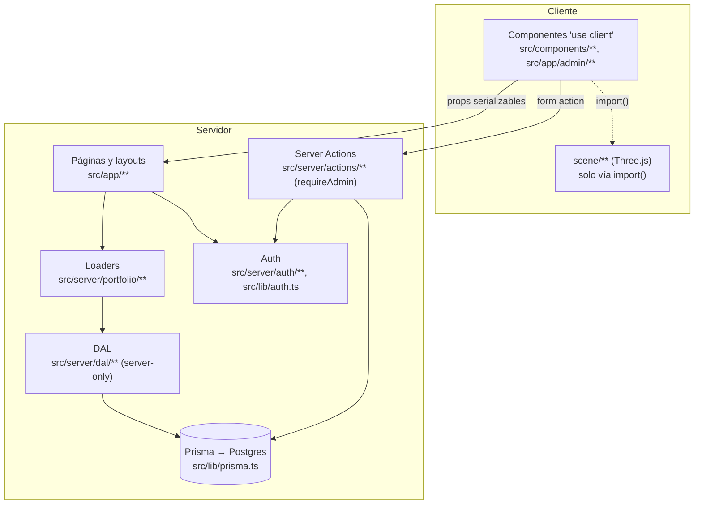

# Arquitectura

Monolito modular en Next.js 16 (App Router). Server Components por defecto; Server Actions para mutaciones; Route Handlers solo para integraciones.

## Capas y dependencias permitidas

`scripts/check-boundaries.mjs` hace cumplir estas flechas (R1–R8). Si una regla molesta, se cambia con una decisión documentada, no con un atajo.

## Rutas

| Ruta | Render | Notas |
|---|---|---|
| `/` | Estática, `revalidate = 86400` | Portada; datos vía `loadPortfolio()` (cacheado por petición) |
| `/proyectos/[slug]` | Estática + `generateStaticParams` | Detalle de proyecto publicado |
| `/admin/**` | Dinámica | Protegida por `proxy.ts` (optimista) + `requireAdmin()` en layout y en cada action |
| `/api/auth/[...all]` | Dinámica | Better Auth |
| `/api/admin/cloudinary/signature` | Dinámica | Firma de subida, solo admin |
| `/api/health` | Dinámica | Comprueba Postgres |

## Caché y plan gratuito
- La web pública nunca se renderiza por visita: Postgres gratuito se suspende tras 5 min y despertarlo cuesta latencia y horas de cómputo.
- Toda mutación del dashboard llama a `revalidatePath("/")` (y `/proyectos/<slug>` si aplica). La regeneración diaria es solo una red de seguridad.
- La traza de la portada se mide al generar la página (servidor) y en el navegador (Navigation Timing). No hay telemetría de pago.

## Capa visual (WebGL)
- El HTML del servidor es la página completa y accesible. WebGL es una capa progresiva encima.
- Three.js vive en `src/components/**/scene/**` y se carga con `import()` tras `requestIdleCallback`. Presupuesto en `docs/ART-DIRECTION.md`; `scripts/check-budgets.mjs` lo verifica.
- Obligatorio: fallback sin WebGL2, `prefers-reduced-motion` (frame estático), modo lectura, pausa con pestaña oculta, `dispose()` completo, calidad adaptativa.

## Datos
Esquema en `prisma/schema.prisma`: `Profile` (singleton `id = "main"`), `SocialLink`, `SkillCategory`/`Skill`, `Project` (+`ProjectImage` COVER/GALLERY, `ProjectRepository`, `ProjectSkill`), `Experience`, `Education`, tablas de Better Auth. Sin perfil publicado no se expone contenido.

## Imágenes
Cloudinary con subida firmada desde el navegador (sin SDK): el servidor firma, el cliente sube, una action registra `publicId/secureUrl/width/height/format/alt`. Borrar una imagen la borra también en Cloudinary.
