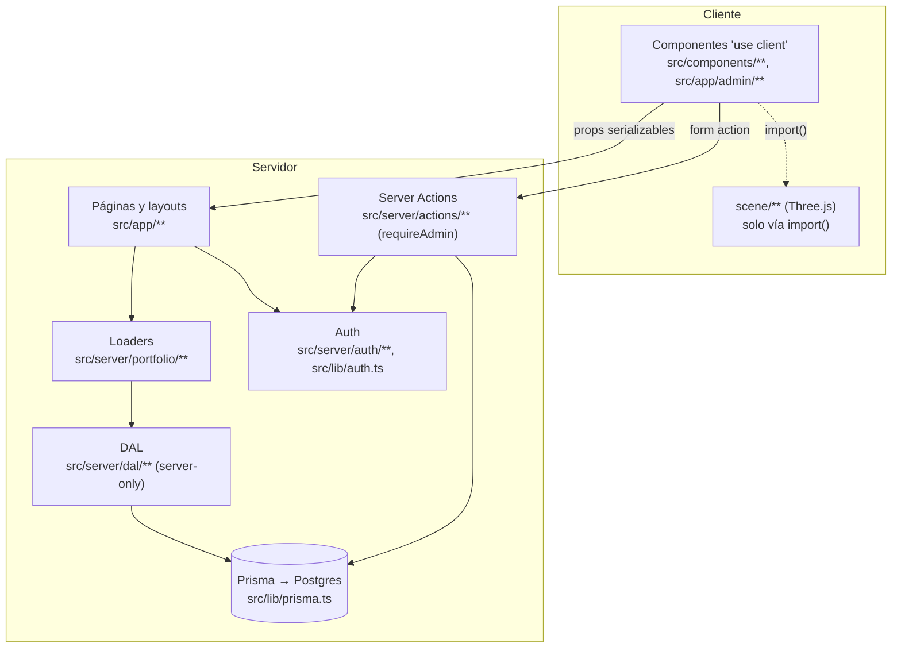

# Arquitectura

Monolito modular en Next.js 16 (App Router). Server Components por defecto; Server Actions para mutaciones; Route Handlers solo para integraciones.

## Capas y dependencias permitidas

`scripts/check-boundaries.mjs` hace cumplir estas flechas (R1–R8). Si una regla molesta, se cambia con una decisión documentada, no con un atajo.

## Rutas

| Ruta | Render | Notas |
|---|---|---|
| `/` | Estática, `revalidate = 86400` | Portada; datos vía `loadPortfolio()` (cacheado por petición) |
| `/proyectos` | Estática, `revalidate = 86400` | Índice de proyectos publicados; filtro por skill en un island cliente (sin JS se ven todos) |
| `/proyectos/[slug]` | Estática + `generateStaticParams` | Ficha completa del proyecto publicado |
| `/stack/[slug]` | Estática + `generateStaticParams` | Skill activa (con categoría activa): sus proyectos publicados y las skills hermanas |
| `/sitemap.xml`, `/robots.txt`, `/opengraph-image` | Estáticas | SEO; URL base en `src/lib/site-url.ts` |
| `/admin/**` | Dinámica | Protegida por `proxy.ts` (optimista) + `requireAdmin()` en layout y en cada action |
| `/api/auth/[...all]` | Dinámica | Better Auth |
| `/api/admin/cloudinary/signature` | Dinámica | Firma de subida, solo admin |
| `/api/health` | Dinámica | Comprueba Postgres |

## Caché y plan gratuito
- La web pública nunca se renderiza por visita: Postgres gratuito se suspende tras 5 min y despertarlo cuesta latencia y horas de cómputo.
- Toda mutación del dashboard llama a `revalidatePortfolio()` (`src/server/actions/common.ts`), que revalida `/`, `/proyectos`, `/proyectos/[slug]` y `/stack/[slug]`. La regeneración diaria es solo una red de seguridad.
- La R5 de `check-boundaries` exige `revalidate` en toda página pública (todo `src/app/**/page.tsx` fuera de `admin/` y `api/`).
- La traza de la portada se mide al generar la página (servidor) y en el navegador (Navigation Timing). No hay telemetría de pago.

## Capa visual (WebGL)
- El HTML del servidor es la página completa y accesible. WebGL es una capa progresiva encima.
- Three.js vive en `src/components/**/scene/**` y se carga con `import()` tras `requestIdleCallback`. Presupuesto en `docs/ART-DIRECTION.md`; `scripts/check-budgets.mjs` lo verifica.
- Obligatorio: fallback sin WebGL2, `prefers-reduced-motion` (frame estático), modo lectura, pausa con pestaña oculta, `dispose()` completo, calidad adaptativa.

## Datos
Esquema en `prisma/schema.prisma`: `Profile` (singleton `id = "main"`), `SocialLink`, `SkillCategory`/`Skill`, `Project` (+`ProjectImage` COVER/GALLERY, `ProjectRepository`, `ProjectSkill`), `Experience`, `Education`, tablas de Better Auth. Sin perfil publicado no se expone contenido: `/` muestra el estado de espera, y las demás rutas devuelven 404 y no se pregeneran.
- **El esquema es el contrato de producto:** cada campo público tiene su sitio en `docs/product/schema-map.json` (`show`, `use` o `internal`). `scripts/check-schema-coverage.mjs` lo comprueba en el gate.
- **Componentes:**
  - `src/components/signal/`: la portada y su escena.
  - `src/components/public/`: piezas compartidas por todas las páginas públicas (cabecera, tarjeta, placa con siglas, chips de skill, repos y fechas).
  - `src/components/admin/`: el dashboard.

## Imágenes
Cloudinary con subida firmada desde el navegador (sin SDK). Las actions solo aceptan URLs `https://res.cloudinary.com/...` (`cloudinaryUrl`), las mismas que `next.config.ts` permite a `next/image`; otro host haría fallar el render público. Flujo: el servidor firma, el cliente sube, una action registra `publicId/secureUrl/width/height/format/alt`. Borrar una imagen la borra también en Cloudinary.

## Producción
Vercel Hobby (`foreverlcd.vercel.app`, despliegue en cada push a `main`) + Neon Postgres 18 (`aws-us-east-1`, la misma región que `iad1`). Detalle y comandos en `docs/DEPLOY.md`.
