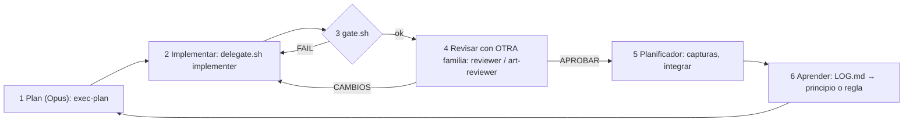

# Arnés de agentes

Cómo se construye foreverlcd.dev con agentes. Combina tres fuentes:
- [Harness engineering (OpenAI, 2026)](https://openai.com/index/harness-engineering/): `AGENTS.md` corto como mapa, `docs/` como fuente de verdad, planes versionados, reglas mecánicas con mensajes de remedio, limpieza continua.
- [Effective harnesses for long-running agents (Anthropic)](https://www.anthropic.com/engineering/effective-harnesses-for-long-running-agents): `feature_list.json` con `passes`, bitácora de progreso, `init.sh`, una funcionalidad por sesión, verificación en navegador.
- El arnés de **Steam Society** (mismo autor): delegación multimotor por roles, gate único, `LOG.md` de "qué le faltó".

**Idea central:** el planificador (Claude Opus) diseña y decide; los motores baratos ejecutan; las máquinas verifican. Cuando un agente falla no se le insiste: se pregunta qué le faltó (documento, regla, herramienta, test), se añade al repo y se anota en `docs/harness/LOG.md`.

## Piezas

| Pieza | Dónde | Para qué |
|---|---|---|
| Mapa | `AGENTS.md` (≈60 líneas) → `docs/00-INDEX.md` | Saber dónde mirar sin cargarlo todo |
| Fuente de verdad | `docs/*.md` | Lo que no está en el repo no existe para el agente |
| Lista de funcionalidades | `docs/feature_list.json` | Qué existe y qué está verificado de punta a punta (`passes`) |
| Progreso | `docs/PROGRESS.md` | Estado, siguiente paso, decisiones recientes |
| Arranque | `scripts/init.sh` | Postgres + dev server + humo, igual en cada sesión |
| Reglas en código | `scripts/check-boundaries.mjs` | Capas, `server-only`, Three.js diferido, auth en actions; cada error dice cómo corregir |
| Presupuestos | `scripts/check-budgets.mjs` | JS inicial y Three.js fuera del bundle |
| Ojos | `scripts/ui-shots.mjs` + `scripts/ui-plans/*.json` | Capturas con WebGL (SwiftShader), fps, errores de consola |
| Gate | `scripts/gate.sh` (`full` con capturas) | Un comando = terminado mínimo |
| Planes | `docs/exec-plans/` | Tareas con lista cerrada de archivos y criterio verificable |
| Roles | `docs/harness/roles/` y `.claude/agents/` | Instrucciones reutilizables por cualquier motor |
| Delegador | `scripts/harness/delegate.sh`, `pipeline.sh` | Mandar un plan a un motor con su rol |

## Ciclo



## Qué motor usar

| Dificultad | Ejemplos | Implementa | Revisa |
|---|---|---|---|
| Baja | textos, estilos, docs, un test | `haiku` u `opencode` (gratis) | `sonnet` |
| Media | componente, action con validación, script | `sonnet` o `codex` | el otro |
| Alta | auth, esquema, escena WebGL principal, dirección de arte | planificador (Opus), o `sonnet` con plan muy detallado | `codex` + `art-reviewer` |

Estado real de los motores (2026-11-18):
- **sonnet / haiku** (`claude -p`): implementan y revisan. Implementadores con herramientas acotadas (sin Bash libre).
- **codex** (`gpt-6-luna`, cuota gratuita de ChatGPT, se agotará): implementa con `-s workspace-write` (sin red: no puede llegar a Postgres ni instalar) y revisa con `-s read-only`.
- **agy** (Antigravity Plus: Sonnet 4.6, Opus 4.6, Gemini 3.8 Flash): **solo revisor**. En headless edita mediante shell y se le deniega; no se le da `--dangerously-skip-permissions`.
- **opencode** (modelos gratuitos): tareas bajas y revisión. **Envía el código a terceros**: nunca en tareas con secretos, auth o datos personales.

Reglas para todos: ninguno hace commit, push ni merge; ninguno lee `.env`; revisores en solo lectura.

## Comandos

```bash
bash scripts/init.sh                      # entorno listo (stop: bash scripts/init.sh stop)
bash scripts/gate.sh                      # verificación; 'full' añade capturas
node scripts/ui-shots.mjs scripts/ui-plans/smoke.json
scripts/harness/delegate.sh sonnet implementer docs/exec-plans/active/<plan>.md
scripts/harness/delegate.sh codex  reviewer    docs/exec-plans/active/<plan>.md
scripts/harness/delegate.sh sonnet art-reviewer docs/exec-plans/active/<plan>.md   # lee .shots/
MODEL=opencode/glm-5.3-flash-free scripts/harness/delegate.sh opencode doc-gardener docs/harness/tasks/garden-all.md
```

Resultados en `.harness/runs/` (ignorado por git).

## Específico de este proyecto
- **Revisión visual obligatoria** para la web pública: `art-reviewer` lee capturas de `.shots/` y las compara con `docs/ART-DIRECTION.md`. Las métricas de fps con SwiftShader (CPU) no representan una GPU real; sirven para detectar regresiones grandes, no para validar rendimiento.
- **Prototipos creativos** fuera del repo (scratchpad) hasta que el dueño elija; solo la dirección elegida entra en `src/`.
- **Limpieza continua:** `doc-gardener` al cerrar cada etapa; hallazgos a `docs/exec-plans/tech-debt-tracker.md`.
